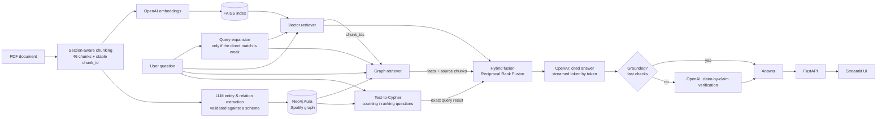

# Hybrid RAG — Spotify-like Web App Architecture

A question-answering app over a software architecture document that combines **vector search (FAISS)** and a **knowledge graph (Neo4j Aura)**, then uses **OpenAI** to write a cited answer and **fact-check it** before showing it.

Built with **FastAPI** (backend) and **Streamlit** (UI), and runs locally or in **Docker**.

> **Why hybrid?** Vector search is good at *"What does the Playback service do?"*.
> A knowledge graph is good at connected, multi-hop questions such as
> *"What happens end to end when an artist uploads a track?"* or
> *"Which services would be affected if PostgreSQL goes down?"*, where the facts are spread across several sections.
> This app uses both and merges the results.

---

## Architecture



### How a question is answered

These steps run in parallel where possible (FAISS, the graph lookups and the LLM calls overlap).

0. **Query expansion** (optional): an LLM rewrites the question into the document's vocabulary (3 search queries + keywords). It only waits for this when the question's direct FAISS match is weak, so most questions don't pay for it.
1. **Vector search**: FAISS returns the top chunks by cosine similarity, searching with every phrasing (one batched embedding call) and merging with RRF.
2. **Graph search** finds the entities the question is about, in two ways:
   - full-text search over entity names, aliases and descriptions
   - entities **mentioned by the FAISS chunks** (`(:Chunk)-[:MENTIONS]->(entity)`). This is the bridge between the two stores.

   It then expands their neighbourhood: 1 hop, plus a 2nd hop along dependency links such as `Service -OWNS_TABLE-> Table` and `Service -NOTIFIES-> Service`.
3. **Text-to-Cypher** (counting / ranking / "list all" questions only): the LLM writes a read-only Cypher query over the whole graph. It's validated (no write keywords, must use `:Spotify`, `LIMIT` enforced) and run in a read transaction with a timeout. The exact result is cited as `[Q1]`.
4. **Fusion**: every graph fact records the chunk(s) it came from, so the graph "votes" for chunks. **Reciprocal Rank Fusion** merges the vector ranking and the graph ranking.
5. **Answer**: OpenAI answers **only** from the context, citing query results `[Q#]`, passages `[C#]`, graph facts `[F#]` and entity summaries `[E#]`. The answer is **streamed** to the UI as it's written.
6. **Verification** (`VERIFY_MODE=auto`): fast checks first, with no LLM call. Every citation must exist, every sentence must be cited, no *inferred* fact may be cited, and retrieval must be confident. If all of that holds, the answer is accepted. Otherwise an LLM judge checks each claim (*supported*, *unsupported* or *contradicted*) and, if needed, rewrites the answer using only supported content.
7. **Cache**: repeated questions are answered instantly from an in-memory cache (cleared on every ingest).

---

## Tech stack

| Layer | Technology |
|---|---|
| LLM & embeddings | OpenAI (`gpt-4o-mini`, `text-embedding-3-small`, both configurable) via `langchain-openai` |
| Vector DB | FAISS (`faiss-cpu`, exact cosine search, JSON docstore with no pickle files) |
| Knowledge graph | Neo4j AuraDB (official `neo4j` Python driver, Cypher) |
| Backend | FastAPI + Uvicorn |
| Frontend | Streamlit |
| PDF parsing | pypdf |
| Config | pydantic-settings + `.env` |
| Deployment | Docker + Docker Compose, behind Traefik (HTTPS via Let's Encrypt, basic auth) on a VPS |

---

## Knowledge graph schema

**Node labels** (every node also has the label `:Spotify`):

| Label | Examples |
|---|---|
| `Layer` | Frontend, Backend, Databases & Storage, Infrastructure & DevOps |
| `Service` | the 17 microservices, e.g. Media Processor Service |
| `Technology` | Next.js, NestJS, PostgreSQL, Redis, Kafka, FFmpeg, Stripe… |
| `Table` | users, playlists, playback_queue, ad_impressions… |
| `Event` | track_uploaded, track_encoded, playback events… |
| `Page` / `PageGroup` | `/home`, `/playlist/:id` / Public, Admin… |
| `FeatureArea` / `Feature` | Playback & Player / "Shuffle & repeat"… |
| `Chunk` | one per text chunk, linked to FAISS by `chunk_id` |

**Relationships:**
- `BELONGS_TO`, `OWNS_TABLE`, `USES`, `INTEGRATES_WITH`, `NOTIFIES`, `FEEDS`, `AGGREGATES`, `LOGS_EVENTS_TO`, `STORES`, `PART_OF`, `IN_GROUP`, `IMPLEMENTED_BY`, `SERVED_BY`, `PUBLISHES`, `CONSUMES`, `CARRIES` (message queue → event), `MENTIONS`
- Each relationship stores `evidence` (`explicit`, meaning stated in the text, or `inferred`) and the `chunk_ids` it came from.

**Extraction quality controls:**
- **Fixed lists from headings.** Services, Feature Areas, Layers and Page Groups are taken from the document headings, and the LLM cannot invent new ones.
- **Structural links in code.** `BELONGS_TO`, `PART_OF`, `IN_GROUP`, and the data-store links `STORES` / `CARRIES`, are derived from the headings, not from the LLM.
- **Validation.** Label pairs are checked for each relationship type, backwards relationships are swapped, and new entities are kept only if they appear in the chunk text.
- **A record of rejections.** Everything rejected is saved in `data/processed/graph_extraction.json` under `dropped`, with the reason.

> **Sharing an Aura instance:** all nodes carry the `:Spotify` label, and the reset, constraint and full-text index are limited to that label. You can run this app on the same free Aura instance as another project without touching that project's data.

---

## Project structure

```
hybrid-rag-spotify/
├── app/
│   ├── config.py                 # settings from .env
│   ├── neo4j_client.py           # shared Neo4j driver
│   ├── pipeline.py               # ask() / ask_stream(): retrieve → answer → verify
│   ├── cache.py                  # answer cache (TTL)
│   ├── evaluation.py             # evaluation metrics
│   ├── ingestion/
│   │   ├── loader.py             # PDF → section-aware chunks
│   │   ├── vector_builder.py     # embeddings → FAISS
│   │   ├── graph_schema.py       # allowed labels / relationships
│   │   ├── graph_extractor.py    # LLM extraction + validation
│   │   ├── graph_builder.py      # write to Neo4j
│   │   └── ingest.py             # full ingest (used by POST /ingest)
│   ├── retrieval/
│   │   ├── vector_retriever.py   # FAISS (single + multi-query)
│   │   ├── graph_retriever.py    # entity linking + 1–2 hop expansion
│   │   ├── cypher_retriever.py   # text-to-Cypher (read-only, validated)
│   │   ├── query_expansion.py    # question → document vocabulary
│   │   └── hybrid.py             # parallel retrieval, RRF fusion, context builder
│   ├── generation/
│   │   ├── answer.py             # cited answer
│   │   └── verify.py             # citation check + LLM fact-check
│   └── api/main.py               # FastAPI
├── ui/streamlit_app.py           # Streamlit UI
├── scripts/                      # CLI helpers (build, test, ask)
├── data/
│   ├── raw/                      # source PDF
│   ├── processed/                # chunks.json, graph_extraction.json
│   └── eval/                     # questions.json + saved evaluation runs
├── vectorstore/                  # FAISS index (generated, not in Git)
├── Dockerfile
├── docker-compose.yml
├── requirements.txt
└── .env.example
```

---

## Getting started (local)

### 1. Prerequisites
- Python 3.13 (3.11+ should work)
- An OpenAI API key
- A Neo4j AuraDB instance (the free tier is enough): <https://console.neo4j.io>

### 2. Install
```bash
git clone https://github.com/pdineshkumar55/hybrid-rag-spotify.git
cd hybrid-rag-spotify
python -m venv venv

# Windows PowerShell
venv\Scripts\Activate.ps1
# macOS / Linux
source venv/bin/activate

pip install -r requirements.txt
```

### 3. Configure
```bash
cp .env.example .env      # then fill in the values
```

| Variable | Description |
|---|---|
| `OPENAI_API_KEY` | Your OpenAI key |
| `OPENAI_CHAT_MODEL` | Chat model (default `gpt-4o-mini`) |
| `OPENAI_EMBED_MODEL` | Embedding model (default `text-embedding-3-small`) |
| `NEO4J_URI` | e.g. `neo4j+s://xxxx.databases.neo4j.io` |
| `NEO4J_USERNAME` / `NEO4J_PASSWORD` | From the Aura credentials file |
| `NEO4J_DATABASE` | Leave empty to use the default database. On newer Aura instances its name is the instance ID, not `neo4j` |
| `FAISS_INDEX_DIR` | Default `vectorstore` |
| `PDF_PATH` | Default `data/raw/spotify_web_app_architecture.pdf` |
| `API_BASE_URL` | Where the UI finds the API (default `http://localhost:8000`) |
| `ADMIN_TOKEN` | Optional. If set, it's required as the `X-Admin-Token` header for `POST /ingest` |
| `QUERY_EXPANSION` | `true` (default) / `false`: rewrite the question before searching |
| `EXPANSION_SKIP_MIN_SCORE` | Default `0.55`: don't wait for expansion when the direct FAISS match is at least this strong |
| `TEXT2CYPHER` | `true` (default) / `false`: generate a Cypher query for counting / ranking questions |
| `VERIFY_MODE` | `auto` (default: skip the verification call when the fast checks pass), `always` or `never` |
| `VERIFY_SKIP_MIN_SCORE` | Default `0.5`: best FAISS score needed for `auto` to skip verification |
| `ANSWER_CACHE_TTL_S` | Default `3600`: how long answers are cached; `0` turns the cache off |
| `RAG_DOMAIN`, `BASIC_AUTH_USERS` | Server only: the public domain and the login used by Traefik (see [Deploying on a VPS](#deploying-on-a-vps-with-traefik)) |

Check the connections:
```bash
python scripts/check_connections.py
```

### 4. Ingest (build both stores)
```bash
python scripts/run_chunking.py          # PDF → data/processed/chunks.json
python scripts/build_vector_store.py    # chunks → FAISS index
python scripts/build_graph.py           # LLM extraction → Neo4j (about 1–3 min, a few cents)

# Reload the graph from the cached extraction, with no LLM calls:
python scripts/build_graph.py --reuse
```

### 5. Run
```bash
# Terminal 1: API (docs at http://localhost:8000/docs)
uvicorn app.api.main:app --reload --port 8000

# Terminal 2: UI (http://localhost:8501)
streamlit run ui/streamlit_app.py
```

### Command-line helpers
```bash
python scripts/test_retrieval.py "Which services use PostgreSQL tables?"  # FAISS vs graph side by side
python scripts/test_hybrid.py "How are subscription payments handled?"    # the exact context sent to the LLM
python scripts/ask.py "What happens after an artist uploads a track?"     # full pipeline with verification
python scripts/evaluate.py --label my-change                             # score the app on the evaluation set
```

---

## Evaluation

`data/eval/questions.json` holds 20 questions with the chunks, graph facts and key points a good answer needs. The question types are descriptive, relational, multi-hop, aggregate (counting / ranking) and out-of-scope.

```bash
python scripts/evaluate.py --label baseline            # full run (verification on)
python scripts/evaluate.py --ids q02 q12               # only some questions while fixing them
python scripts/evaluate.py --no-verify                 # faster: one LLM call per question
```

Each run prints a scorecard, the failures (missing chunks, facts or key points), averages per stage, and the **change from the previous run**. Runs are saved in `data/eval/runs/`.

| Metric | Meaning |
|---|---|
| `pass_rate` | The answer covers every key point; out-of-scope questions must be declined |
| `chunk_recall` / `vector_recall` | Share of the expected chunks that reached the LLM (all retrievers / FAISS only) |
| `graph_rescued_chunks` | Expected chunks that only the graph found |
| `fact_recall` | Share of the expected graph facts returned |
| `keyword_coverage` | Share of the key points present in the answer |
| `verified_supported` / `verify_skipped` | Answers the LLM judge fully supported / answers accepted by the fast checks |
| `avg_seconds` + `avg time per stage` | Latency, and where it goes |

---

## Run with Docker

```bash
cp .env.example .env            # fill in your keys
docker compose up --build
```
- UI: <http://localhost:8502>
- API docs: <http://localhost:8000/docs>

Both ports are bound to `127.0.0.1`, so they're reachable only from the machine itself. On a server, Traefik is the public entry point.

| Detail | How it works |
|---|---|
| **Image** | One image runs two containers, `api` and `ui`. The UI waits until the API's `/health` check passes |
| **Credentials** | Passed in at runtime with `env_file: .env`. They are **never** copied into the image |
| **Data** | `./data` and `./vectorstore` are mounted as volumes, so an index built locally is reused and rebuilds persist |
| **Container networking** | The UI reaches the API at `http://api:8000` |

If the FAISS index doesn't exist yet (for example, on a fresh server):
```bash
mkdir -p vectorstore
sudo chown -R 1000:1000 data vectorstore      # Linux only: the container runs as UID 1000
docker compose run --rm api python scripts/build_vector_store.py
docker compose up -d
```

---

## API

| Method | Endpoint | Description |
|---|---|---|
| `GET` | `/health` | FAISS vector count, Neo4j `:Spotify` node count, model names |
| `POST` | `/query` | `{"question": "...", "verify": true}` → answer, draft, verification, sources, retrieval details, timings |
| `POST` | `/query/stream` | Same request, streamed as newline-delimited JSON: `{"type":"retrieval"}` → `{"type":"token","text":...}` × N → `{"type":"final","result":{...}}` |
| `GET` | `/graph/stats` | Node and relationship counts |
| `POST` | `/ingest` | Rebuild FAISS and/or the graph as a background job (`X-Admin-Token` header if `ADMIN_TOKEN` is set) |
| `GET` | `/ingest/status` | State and log of the last ingest job |

Example:
```bash
curl -X POST http://localhost:8000/query \
  -H "Content-Type: application/json" \
  -d '{"question": "Which services and tables implement the Playback & Player features?"}'
```

Response (shortened):
```json
{
  "answer": "Playback & Player is implemented by the Playback & Session Service [F8] ...",
  "was_corrected": false,
  "verification": { "verdict": "supported", "confidence": "high", "claims": [ ... ] },
  "sources": [ { "label": "C1", "type": "passage", "chunk_id": "spotify-s02-07", ... } ],
  "timings": { "retrieval_s": 0.9, "answer_s": 2.1, "verify_s": 2.4, "total_s": 5.4 }
}
```

---

## Streamlit UI

- **Chat** with the answer **streamed as it's written**, then a verification badge with its confidence: ✅ verified, ⚡ grounded (fast checks passed), ⚠️ partially supported, ❌ not supported, or ℹ️ not in the document. Cached answers are marked.
- **🧮 Graph query**: for counting / ranking questions, the generated Cypher query and its result table.
- **📄 Passages**: each retrieved chunk, labelled by retriever (🔎 vector, 🕸️ graph or both). Cited passages open automatically.
- **🕸️ Graph facts**: a diagram of the facts (solid lines are stated, dashed are inferred) plus a table.
- **✔️ Verification**: a claim-by-claim check with citations.
- **🔧 Retrieval**: the query expansion (or why it was skipped), the fused ranking and timings, for debugging.
- **Sidebar**: backend health, sample questions, and an admin panel to rebuild the data.

---

## Example questions

- What happens after an artist uploads a track?
- Which services and tables implement the Playback & Player features?
- How does the app handle subscription payments?
- Which services use PostgreSQL tables?
- What is stored in ClickHouse?
- Which frontend pages are served by the Library & Playlist Service?
- How many microservices does the architecture define? *(text-to-Cypher)*
- Which service owns the most tables? *(text-to-Cypher)*

---

## Troubleshooting

| Problem | Fix |
|---|---|
| `ServiceUnavailable` from Neo4j | The Aura Free instance is paused. Resume it in the Aura console |
| `DatabaseNotFound ... database 'neo4j'` | Leave `NEO4J_DATABASE` empty, or set it to your Aura instance ID |
| `AuthError` | Use the username exactly as written in the Aura credentials file |
| `No FAISS index in 'vectorstore'` | Run `python scripts/build_vector_store.py` |
| `Index was built with '<model>'…` | You changed `OPENAI_EMBED_MODEL`. Rebuild the FAISS index |
| Docker: `ports are not available` | Another process (often a local Streamlit or Uvicorn) is using 8000 or 8501. Stop it, or change the host port in `docker-compose.yml` |
| Docker on Linux: `Permission denied` writing `vectorstore/` | `sudo chown -R 1000:1000 data vectorstore` |
| Traefik returns `404 page not found` for every site | Traefik lost its Docker connection (logs: `Cannot connect to the Docker daemon`). Run `docker restart <traefik container>` |
| Browser shows "TRAEFIK DEFAULT CERT" | DNS didn't resolve when Traefik requested the certificate. Once it resolves, run `docker compose up -d --force-recreate ui` |

---

## Deploying on a VPS with Traefik

This setup is used on a Hostinger VPS where **Traefik** already serves other apps on ports 80/443.

1. Point a DNS **A record** (e.g. `rag`) at the VPS IP.
2. Clone the repo, create `.env`, and add the two server-only settings:
   ```bash
   htpasswd -nbB <user> '<password>'          # from apache2-utils
   ```
   ```
   RAG_DOMAIN=rag.example.com
   BASIC_AUTH_USERS='<paste the htpasswd line, in SINGLE quotes>'
   ```
3. Build the FAISS index on the server, then start the containers (see [Run with Docker](#run-with-docker)).

The `ui` service's labels in `docker-compose.yml` register the app with Traefik: HTTPS through the `letsencrypt` resolver, the basic-auth login, and `/healthz` without a login. Change the entrypoint and resolver names if your Traefik uses different ones.

**Keep Aura Free awake.** Free instances pause after a few days without queries. A daily health check prevents that:
```bash
crontab -e
# add:
17 3 * * * curl -fsS -m 30 http://127.0.0.1:8000/health > /dev/null 2>&1
```

**Update after a push:**
```bash
git pull && docker compose up -d --build
```

---

## Security notes for deployment

- Never commit `.env`. It is excluded by both `.gitignore` and `.dockerignore`.
- The UI talks to the API over Docker's internal network, so **don't expose port 8000 publicly**. Open only the UI port, or put it behind a reverse proxy.
- Set `ADMIN_TOKEN` so nobody else can trigger `/ingest`.
- The Streamlit UI has no login of its own. Keep it behind the reverse proxy's basic auth (Traefik here) so others can't spend your OpenAI credits, and set a monthly budget limit in the OpenAI dashboard.
- Text-to-Cypher queries are validated and run in **read** transactions with a timeout, so a generated query can't change data.

---

## Roadmap

- [x] Evaluation set and scoring script
- [x] Query expansion, parallel retrieval, answer cache, auto-verification
- [x] Streaming answers
- [x] Text-to-Cypher for counting / ranking questions
- [x] HTTPS + basic auth behind Traefik
- [ ] Larger held-out evaluation set and an LLM-judge correctness score
- [ ] Graph fact ranking by relevance to the top chunks
- [ ] Follow-up questions (chat history) and 👍/👎 feedback
- [ ] Support for uploading other architecture documents (per-document schema)

---

## Author

**Dineshkumar Palanisamy** · [GitHub](https://github.com/pdineshkumar55) · [LinkedIn](https://linkedin.com/in/pdineshkumar55)

Built as a hands-on Generative AI learning project on hybrid RAG (vector search plus a knowledge graph).
